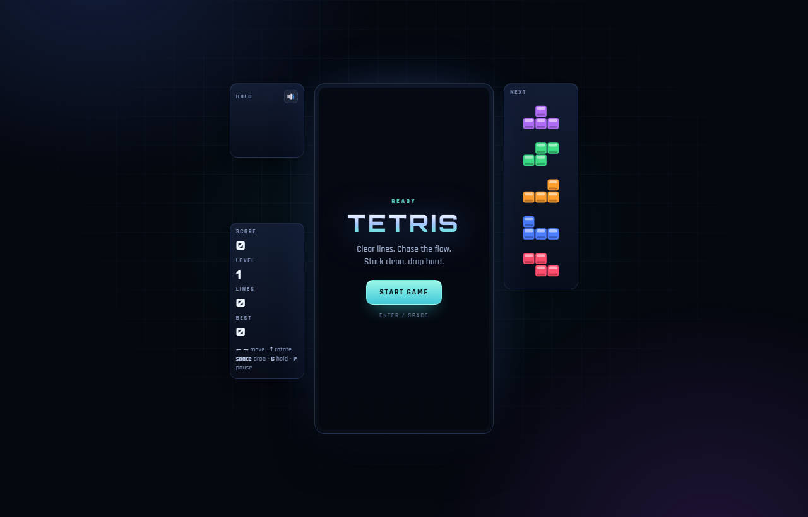

# Tetris

A complete, polished Tetris game for the browser. One HTML file, no build step, no dependencies.



## Play

- **Locally:** open `index.html` in any modern browser.
- **Online:** enable GitHub Pages (see below) and play from the published URL.

## Features

- **Modern Tetris rules** — SRS rotation with wall kicks, 7-bag randomizer, hold piece, 5-piece next queue, ghost piece, lock delay with move resets.
- **Full scoring** — singles, doubles, triples, Tetris, T-spins (including minis), back-to-back bonuses, combos, and perfect-clear bonuses.
- **20 speed levels** — gravity accelerates every 10 lines, capped at level 20.
- **Game feel** — line-clear flash, debris particles, screen shake, floating callouts, and a tiny WebAudio synth (no sound assets).
- **Responsive** — keyboard on desktop, on-screen touch pad on phones and tablets.
- **Quality of life** — pause, auto-pause on tab blur, saved best score, sound toggle.
- **Zero dependencies** — no frameworks, no bundler, no network calls required to play (the font is optional).

## Controls

| Action | Keyboard | Touch |
| --- | --- | --- |
| Move left / right | `←` / `→` | ◀ / ▶ |
| Soft drop | `↓` | ▼ |
| Rotate clockwise | `↑` or `X` | ↻ |
| Rotate counter-clockwise | `Z` or `Ctrl` | — |
| Rotate 180° | `A` | — |
| Hard drop | `Space` | ⤓ |
| Hold | `C` or `Shift` | H |
| Pause | `P` or `Esc` | — |
| Mute | `M` | speaker icon |

Horizontal movement uses DAS/ARR auto-repeat: hold a direction to slide.

## Scoring

| Clear | Base points |
| --- | --- |
| Single | 100 × level |
| Double | 300 × level |
| Triple | 500 × level |
| Tetris | 800 × level |
| T-Spin single / double / triple | 800 / 1200 / 1600 × level |
| Mini T-Spin single / double | 200 / 400 × level |
| Back-to-back | × 1.5 |
| Combo | + 50 × combo × level |
| Perfect clear | + 2000 × level |
| Soft drop | 1 per cell |
| Hard drop | 2 per cell |

Level increases every 10 lines. Best score is stored in `localStorage`.

## Run locally

No server is required — double-click `index.html`. If you prefer a local server:

```bash
# Python 3
python -m http.server 8080

# or Node
npx serve .
```

Then open <http://localhost:8080>.

## Publish to GitHub Pages

1. Create an empty repository on GitHub (for example `tetris`).
2. From this folder:

   ```bash
   git remote add origin https://github.com/<your-username>/tetris.git
   git push -u origin main
   ```

3. On GitHub go to **Settings → Pages**, set **Source** to *Deploy from a branch*, choose **main** and **/ (root)**, then save.
4. Your game will be live at `https://<your-username>.github.io/tetris/`.

## Project structure

```
tetris/
├── index.html          # the entire game: markup, styles, and engine
├── docs/
│   └── screenshot.png  # image used in this README
├── LICENSE
└── README.md
```

Inside `index.html` the code is split into clearly commented sections: rules/constants, canvas setup, audio synth, game state, update loop, rendering, overlays, and input.

## License

[MIT](LICENSE)
